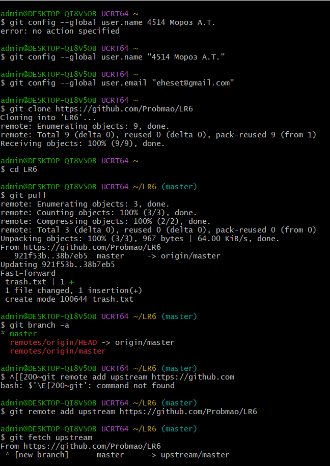
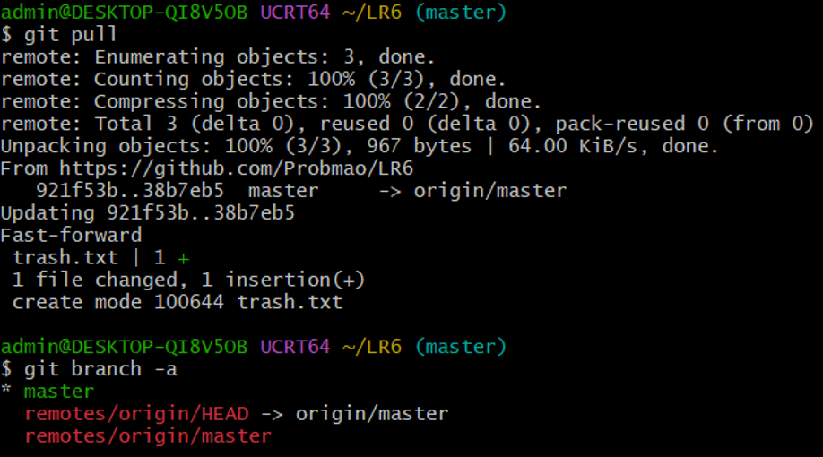
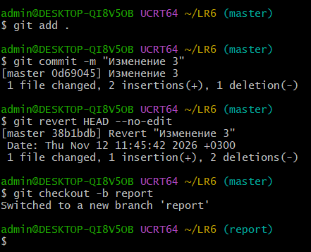

# Лабораторная работа №6
**Тема:** Система контроля версий Git  
**Выполнил:** студент группы 4514 Мороз А.Т.

## Лог выполненных команд

```bash
git config --global user.name "4514 Мороз А.Т."
git config --global user.email "eheset@gmail.com"
git clone https://github.com
cd LR6
git pull
git branch -a
git remote set-url upstream https://github.com
git fetch upstream
git branch -a
git checkout -b branch1 upstream/branch1
git log --oneline
git checkout master
git log --oneline
git show
git merge branch1
git add mergefile.txt
git commit -m "Разрешен конфликт при слиянии с branch1"
git branch -d branch1
git remote remove upstream
git add .
git commit -m "Изменение 1"
git add .
git commit -m "Изменение 2"
git add .
git commit -m "Изменение 3"
git revert HEAD --no-edit
git checkout -b report
```

## Скриншоты выполнения работы

### 1. Настройка Git, клонирование и синхронизация репозитория


### 2. Получение ветки branch1 и просмотр истории коммитов


### 3. Просмотр изменений, слияние веток, разрешение конфликта и создание коммитов


### 4. Завершение серии коммитов, откат и создание ветки для отчёта



##История операций
```
ef276ea - 2026-11-12 - 4514 Мороз А.Т. : Оформлен отчет в README.md
0e2a507 - 2026-11-12 - 4514 Мороз А.Т. : Добавлена папка со скриншотами выполнения работы
38b1bdb - 2026-11-12 - 4514 Мороз А.Т. : Revert "Изменение 3"
0d69045 - 2026-11-12 - 4514 Мороз А.Т. : Изменение 3
c059f1c - 2026-11-12 - 4514 Мороз А.Т. : Изменение 2
19a1d62 - 2026-11-12 - 4514 Мороз А.Т. : Изменение 1
44b3c8a - 2026-11-12 - 4514 Мороз А.Т. : Разрешен конфликт при слиянии с branch1
38b7eb5 - 2026-11-12 - Probmao : Add files via upload
921f53b - 2020-11-21 - Kurtyanik : Обновление информации
0f9f50d - 2020-11-21 - Kurtyanik : Заполнил файл
c08a654 - 2020-11-21 - Kurtyanik : Файл создан пустым
3c6e913 - 2020-11-21 - Kurtyanik : Initial commit
```