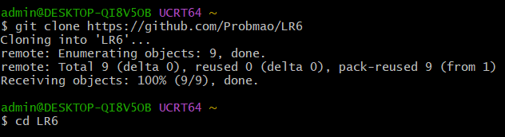
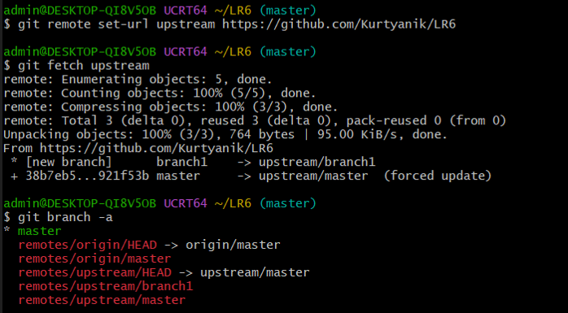
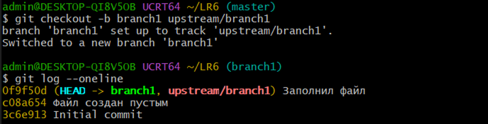
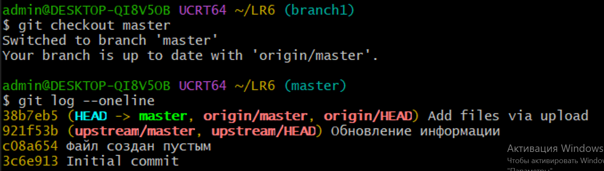
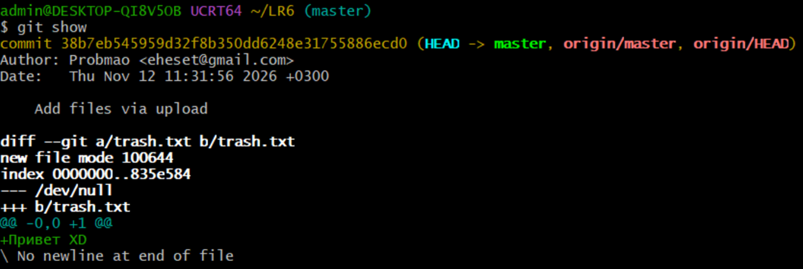
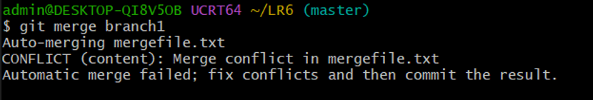
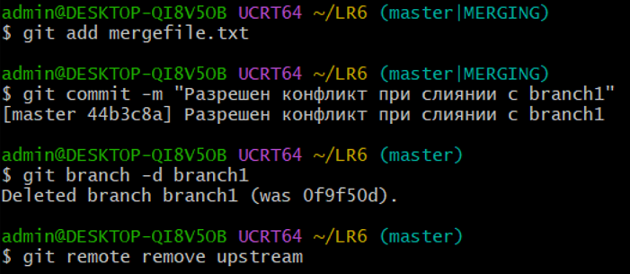
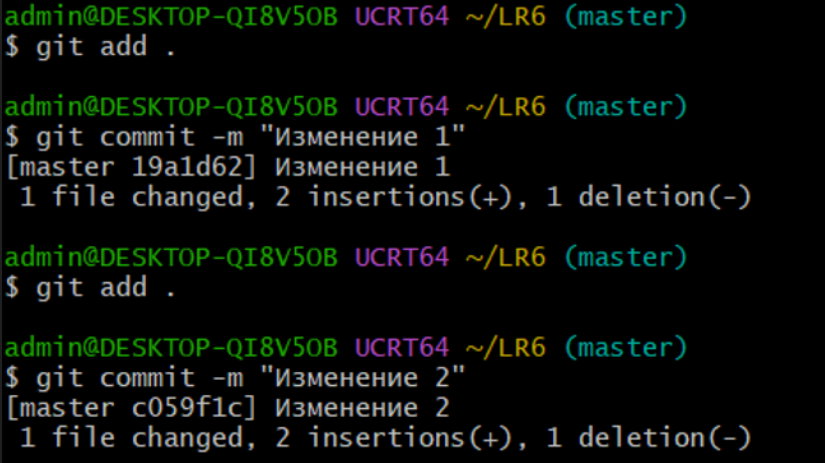
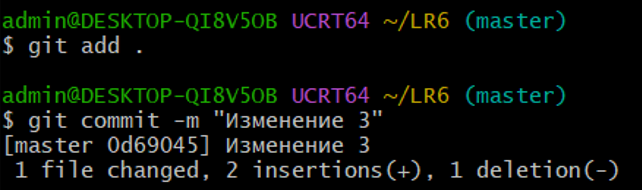
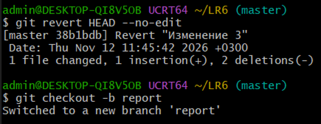

# Лабораторная работа №6
**Тема:** Система контроля версий Git  
**Выполнил:** студент группы 4514 Мороз А.Т.

## Цель работы
Изучение базовых возможностей системы управления версиями, опыт работы с Git API, получение навыков работы с локальным и удаленным репозиториями, управление ветками, разрешение конфликтов слияния и отмена изменений.

---

## Подробный ход выполнения работы

### Этап 1. Глобальная настройка клиента Git
Для идентификации автора во всех последующих коммитах выполнена первоначальная глобальная конфигурация имени пользователя (в формате Группа Фамилия И.О.) и адреса электронной почты:
```bash
git config --global user.name "4514 Мороз А.Т."
git config --global user.email "eheset@gmail.com"
```
*Скриншот глобальной настройки Git:*  


---

### Этап 2. Клонирование удаленного репозитория
Репозиторий был форкнут на GitHub, после чего его копия скопирована на локальный компьютер для ведения разработки. Выполнен переход в рабочую директорию проекта.
```bash
git clone https://github.com
cd LR6
```
*Скриншот клонирования удаленного репозитория:*  


---

### Этап 3. Синхронизация с личным удаленным репозиторием
Выполнена проверка связи с собственным удаленным репозиторием на GitHub. Подтянуты последние изменения и выведен список всех существующих на данный момент локальных и удаленных веток проекта.
```bash
git pull
git branch -a
```
* **Что изображено на Скриншоте 3:** Процесс выполнения команды `git pull` (показывающий статус `Already up to date` или скачивание файлов) и базовый список веток, где видны только локальная ветка `master` и её удаленная копия `remotes/origin/master`.

*Скриншот этапа синхронизации:*  


---

### Этап 4. Подключение и обновление оригинального репозитория (Upstream)
Для возможности работы с ветками из исходного репозитория преподавателя был добавлен и настроен удаленный источник с именем `upstream`. Выполнено скачивание (`fetch`) метаданных, после чего запрошен обновленный список веток.
```bash
git remote set-url upstream https://github.com
git fetch upstream
git branch -a
```
* **Что изображено на Скриншоте 3_2:** Успешный процесс индексации объектов при выполнении `git fetch upstream` и итоговый расширенный список веток, в котором (выделенные красным цветом) появились новые ветки оригинального репозитория: `remotes/upstream/master` и `remotes/upstream/branch1`.

*Скриншот настройки оригинального репозитория:*  


---

### Этап 5. Переключение на ветку branch1 и анализ истории
Создана локальная ветка `branch1`, связанная с соответствующей удаленной веткой источника `upstream`, и выполнен автоматический переход на нее. Проведен анализ однострочного лога коммитов.
```bash
git checkout -b branch1 upstream/branch1
git log --oneline
```
*Скриншот переключения на ветку branch1 и анализа истории:*  


---

### Этап 6. Анализ истории и изменений главной ветки master
Выполнен возврат из рабочей ветки `branch1` в главную ветку `master` для сопоставления расхождений в хронологии разработки. Была изучена краткая однострочная история коммитов текущей ветки, а также проведена детальная проверка последнего коммита для анализа измененных файлов и строк кода.
```bash
git checkout master
git log --oneline
git show
```

#### Ход анализа:
1. **Переключение и лог коммитов:** При переключении на ветку `master` система уведомила о полной синхронизации с `origin/master`. Вывод команды `git log --oneline` показал цепочку из 4 коммитов, где верхним (HEAD) является коммит автора `38b7eb5` с комментарием `"Add files via upload"`.
2. **Исследование изменений через `git show`:** Детальный разбор последнего коммита показал полные метаданные (хэш, автор, дата) и текстовый дифференциал (diff). В репозиторий был добавлен новый файл `trash.txt` с одной строкой текста: `+Привет XD`.

*Скриншоты переключения, истории и анализа изменений:*  
  


---

### Этап 7. Запуск слияния и фиксация конфликта (Merge Conflict)
При попытке слить наработки из ветки `branch1` в ветку `master` возник конфликт слияния в файле `mergefile.txt`, так как в одной и той же строке файла содержались разные данные в двух ветках.
```bash
git merge branch1
```
*Скриншот запуска слияния и фиксации конфликта:*  


---

### Этап 8. Ручное разрешение конфликта слияния
Файл `mergefile.txt` был открыт в текстовом редакторе. Служебные маркеры Git были вручную удалены, а конфликтующие строки объединены. Исправленный файл подготовлен к коммиту и зафиксирован. Побочная ветка `branch1` и связь с `upstream` удалены за ненадобностью.

#### Содержимое файла `mergefile.txt` во время конфликта:
```text
<<<<<<< HEAD
Данные из ветки master (оригинальный текст)
=======
Данные из ветки branch1 (альтернативный текст)
>>>>>>> branch1
```

#### Содержимое файла `mergefile.txt` после разрешения конфликта:
```text
Данные из ветки master (оригинальный текст)
Данные из ветки branch1 (альтернативный текст)
```

```bash
git add mergefile.txt
git commit -m "Разрешен конфликт при слиянии с branch1"
git branch -d branch1
git remote remove upstream
```
*Скриншот разрешения конфликта:*  


---

### Этап 9. Создание последовательности изменений (Линейная история)
Для демонстрации процесса поэтапной фиксации работы в репозитории была создана и закоммичена серия из трех последовательных изменений в файловой структуре кода. Каждый логический шаг сопровождался индексацией файлов и созданием уникального коммита с индивидуальным комментарием.
```bash
git add .
git commit -m "Изменение 1"
git add .
git commit -m "Изменение 2"
git add .
git commit -m "Изменение 3"
```

#### Ход фиксации изменений:
1. **Первая серия фиксаций (image_172GfS.png):** Выполнено добавление текущих правок через `git add .` и успешно создан первый коммит `19a1d62` с описанием `"Изменение 1"`. Следом за ним проведен повторный цикл индексации и создан второй коммит `c059f1c` с комментарием `"Изменение 2"`. В обоих случаях система зафиксировала изменение 1 файла.
2. **Завершение серии изменений (image_ONzCyt.png):** Проведен финальный цикл добавления модифицированных данных в индекс. Выполнена команда `git commit -m "Изменение 3"`, в результате чего сформирован третий последовательный коммит с хэшем `0d69045`.

*Скриншоты фиксации последовательности изменений:*  
  


---

### Этап 10. Откат коммита и создание ветки для отчёта
Для безопасной отмены последнего действия («Изменение 3») без перезаписи публичной истории была использована команда `git revert`. Git автоматически создал новый компенсирующий коммит. После этого создана отдельная целевая ветка `report` для оформления отчета.
```bash
git revert HEAD --no-edit
git checkout -b report
```
*Скриншот отката коммита и создание ветки для отчёта:*  


---

## Полная история операций (Лог репозитория)
Вывод команды формирования форматированного лога (сокращенный хэш + дата + имя автора + комментарий):

```text
ef276ea - 2026-11-12 - 4514 Мороз А.Т. : Оформлен отчет в README.md
0e2a507 - 2026-11-12 - 4514 Мороз А.Т. : Добавлена папка со скриншотами выполнения работы
38b1bdb - 2026-11-12 - 4514 Мороз А.Т. : Revert "Изменение 3"
0d69045 - 2026-11-12 - 4514 Мороз А.Т. : Изменение 3
c059f1c - 2026-11-12 - 4514 Мороз А.Т. : Изменение 2
19a1d62 - 2026-11-12 - 4514 Мороз А.Т. : Изменение 1
44b3c8a - 2026-11-12 - 4514 Мороз А.Т. : Разрешен конфликт при слиянии с branch1
38b7eb5 - 2026-11-12 - Probmao : Add files via upload
921f53b - 2020-11-21 - Kurtyanik : Обновление информации
0f9f50d - 2020-11-21 - Kurtyanik : Заполнил файл
c08a654 - 2020-11-21 - Kurtyanik : Файл создан пустым
3c6e913 - 2020-11-21 - Kurtyanik : Initial commit
```

---

## Полный перечень выполненных консольных команд

```bash
git config --global user.name "4514 Мороз А.Т."
git config --global user.email "eheset@gmail.com"
git clone https://github.com
cd LR6
git pull
git branch -a
git remote set-url upstream https://github.com
git fetch upstream
git branch -a
git checkout -b branch1 upstream/branch1
git log --oneline
git checkout master
git log --oneline
git show
git merge branch1
git add mergefile.txt
git commit -m "Разрешен конфликт при слиянии с branch1"
git branch -d branch1
git remote remove upstream
git add .
git commit -m "Изменение 1"
git add .
git commit -m "Изменение 2"
git add .
git commit -m "Изменение 3"
git revert HEAD --no-edit
git checkout -b report
```

---

## Выводы
В ходе выполнения лабораторной работы были освоены практические навыки работы с распределенной системой контроля версий Git. Изучены процессы инициализации настроек автора, клонирования удаленных репозиториев и управления ветками. На практике освоен механизм слияния изолированных веток кода (`git merge`) и ручного разрешения возникающих конфликтов (Merge Conflicts) путем удаления служебных маркеров Git. Была изучена разница между коммитами изменений и их безопасной отменой с помощью механизма `git revert`, позволяющего сохранить целостность общей истории разработки. Получен опыт разметки документации в формате Markdown.
